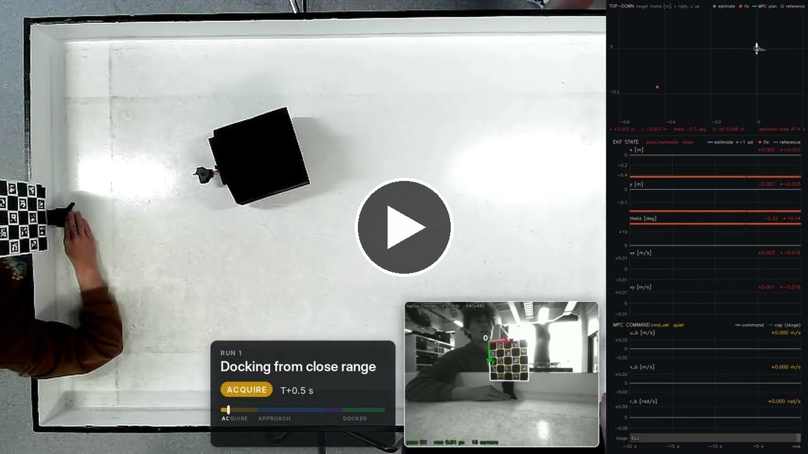
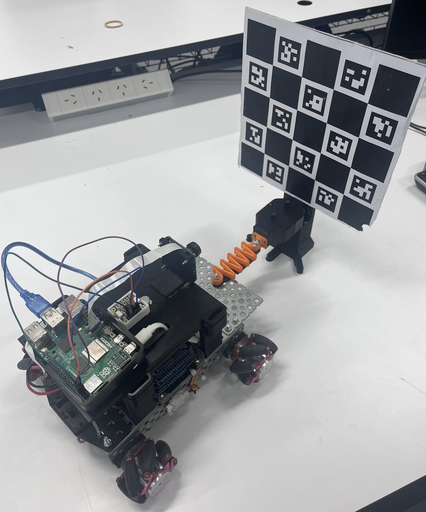
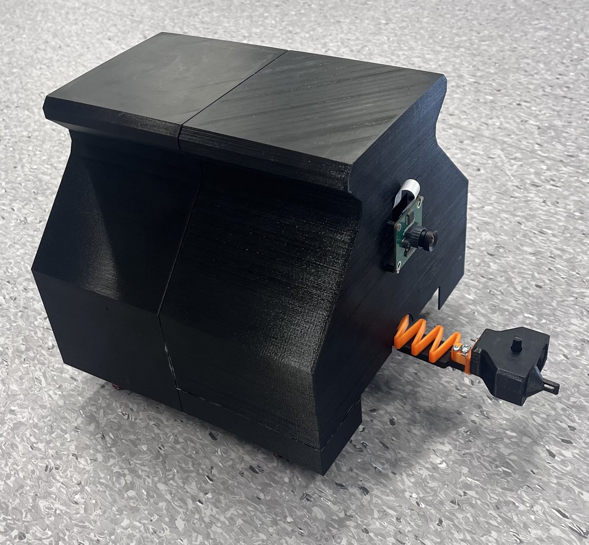
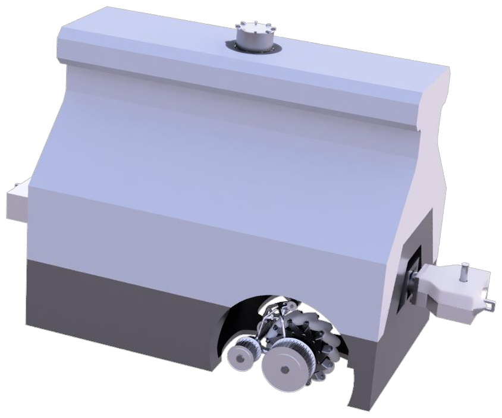
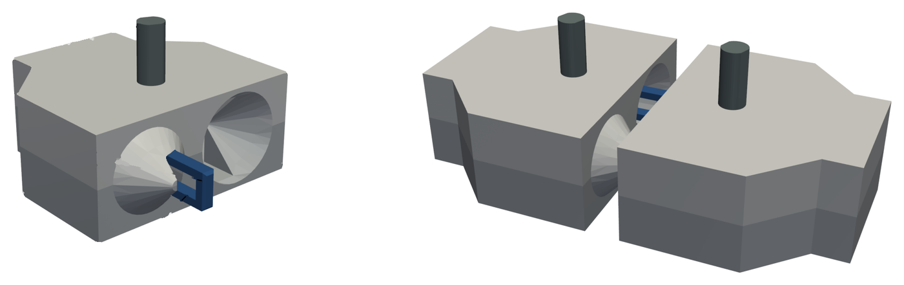
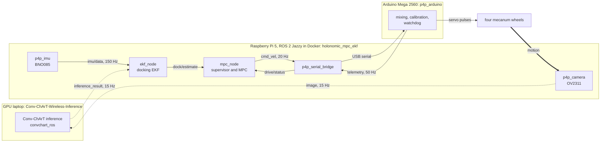

# Robust Autonomous Docking and Traversal of Robotic Motorway Barriers

**Project 41 (ME041-2026), Part IV research project in Mechatronics Engineering, University of Auckland.**<br>
Adam Wright and Kaelin Graf-Ogilvie, supervised by Professor Peter Xu.

The Auckland Harbour Bridge reallocates its lanes with a movable barrier: a 2.2 km chain of
concrete units shifted one lane at a time by two purpose-built transfer machines. Project 41 puts
each barrier unit on its own mecanum base instead, so that the chain can reconfigure itself:
modules uncouple, cross the lane under their own control and dock with their neighbours again.
This repository is the front door to the software behind that docking sequence, which runs on a
scale prototype.

[](https://youtu.be/CLiSylixJYE)

**[Watch the docking video on YouTube](https://youtu.be/CLiSylixJYE).** Four docking sequences on
the scale prototype (from close range, from long range, from the side and towards a moving
target), filmed from overhead with the estimator's state and the controller's commands shown
alongside.

## The prototype and the full-scale design

<p align="center">
  
  
  
</p>
<p align="center"><em>The scale prototype docked to its target, the prototype in its case, and the full-scale barrier module (CAD).</em></p>

The **scale prototype** is a 232 × 232 mm tabletop mecanum robot that runs the full-scale docking
sequence against a fixed target: a 1:4 printed coupler below a 5 × 5 ChArUco board. A Raspberry
Pi 5 runs the state estimator and the controller on board, an Arduino Mega 2560 drives the
wheels, and the fiducial detector runs on a GPU laptop over Wi-Fi. In the final trials, 16 of 18
approaches docked from up to 1.9 m away, each latching inside the coupler's ±12 mm capture window.

The **full-scale module** carries a barrier unit of the existing 998 × 598 × 812 mm envelope
(about 600 kg) on a steel base with mecanum wheels and a ride-height mechanism, and has a coupler
on each end face. The coupler adapts the Scharfenberg rail coupler: every face carries a cone, a
recess, a bar and a spring-returned hook, so any face docks with any other and latches passively.
Scaled from tests on 1:4 printed couplers, it captures from up to ±48 mm and ±20° of misalignment.

<p align="center">
  
</p>
<p align="center"><em>The full-scale coupler (CAD): one head, and two heads coupled.</em></p>

## Repositories

Everything the docking sequence runs is in four repositories, pinned here as git submodules at
their latest commits (see [Getting the code](#getting-the-code)). The simulation studies are not
included.

| Repository | Pinned commit | Runs on | Role |
|---|---|---|---|
| [**Conv-ChArT**](https://github.com/KaelinGraf/Conv-ChArT) | [`d7ade8e`](https://github.com/KaelinGraf/Conv-ChArT/tree/d7ade8eeb67d4455d7bd55b7eb3758136955d364) | GPU workstation | Trains the network that finds the docking board and solves its pose |
| [**Conv-ChArT-Wireless-Inference**](https://github.com/KaelinGraf/Conv-ChArT-Wireless-Inference) | [`f6d26bc`](https://github.com/KaelinGraf/Conv-ChArT-Wireless-Inference/tree/f6d26bc114f8685534d417839c188d78528bfaaa) | GPU laptop | Runs that network on the robot's images over Wi-Fi; holds the shared ROS 2 interfaces and the Pi's container |
| [**holonomic_mpc_ekf**](https://github.com/KaelinGraf/holonomic_mpc_ekf) | [`bfac215`](https://github.com/KaelinGraf/holonomic_mpc_ekf/tree/bfac2150411bb53ee6c127b6cd3c24a24a6af84f) | Raspberry Pi 5 | The docking EKF, supervisor and MPC, and the robot's camera, IMU and drive nodes |
| [**p4p_arduino**](https://github.com/adamwright103/p4p_arduino) | [`0feb0bc`](https://github.com/adamwright103/p4p_arduino/tree/0feb0bc00b593561544c4d7b60b1e35213e90bfb) | Arduino Mega 2560 | Drive firmware: wheel mixing and calibration, watchdog and interlocks |

### [Conv-ChArT](https://github.com/KaelinGraf/Conv-ChArT): the perception model

A convolutional network with transformer (attention) blocks that detects and identifies all 16
inner corners of a 5 × 5 ChArUco board in one pass and refines each to sub-pixel accuracy. A
geometry stage then fits the corners to the board's lattice and solves the board's pose. The
network is trained entirely on synthetic images, and can be fine-tuned without labels on video of
the board.

- `dcc/`: the synthetic data generator, the detector and refiner networks, and the pose pipeline
- `tools/`: training, the data acceptance audit, evaluation sets, introspection, and
  self-supervised fine-tuning from video
- `docs/ARCHITECTURE.md`: the design and the reasoning behind it

### [Conv-ChArT-Wireless-Inference](https://github.com/KaelinGraf/Conv-ChArT-Wireless-Inference): the perception link

The Pi cannot run Conv-ChArT at 15 Hz, so the robot streams 640 × 480 greyscale images to a GPU
laptop and receives poses back. This repository holds the laptop's side of that link and what both
machines share.

- `src/inference.py`, `checkpoints/`: the Conv-ChArT pipeline on ONNX Runtime, with the released
  weights
- `convchart_ros`: the laptop's ROS 2 nodes, started by task from `convchart.launch.py`. The
  inference node publishes each pose with a range-dependent covariance, and the telemetry
  dashboard shows the camera, estimator and controller live, arms and starts the docking, and
  records each attempt. Camera calibration and self-supervised fine-tuning on the robot's own
  frames live here too.
- `convchart_interfaces`, `convchart_qos`: the messages, services and QoS profiles both machines
  build against
- `compose.yaml`, `docker/`: the Pi's ROS 2 Jazzy container, its host setup (camera pipeline, I2C)
  and the CycloneDDS profiles for the Wi-Fi link
- `cfg/cfg.yaml`: the deployed model, board and camera calibration; `docs/board_5x5_200mm_A4.pdf`
  is the board, ready to print

### [holonomic_mpc_ekf](https://github.com/KaelinGraf/holonomic_mpc_ekf): estimation, control and the robot's nodes

Everything on the robot's Raspberry Pi 5, which runs ROS 2 Jazzy in the container above, with the
camera, the EKF and the MPC each on their own core at real-time priority.

- `dock_control`: the docking EKF, driven by the IMU, which applies each delayed pose at its
  capture time and replays the steps since; the supervisor, which runs the stages of the docking
  sequence and its hold and abort rules; and the MPC, which solves one quadratic program per
  20 Hz tick for the body-velocity command. `config/dock_demo.yaml` holds every parameter.
- `dock_msgs`: the estimate, stage, fix and MPC diagnostic messages
- `p4p_nodes/`: `p4p_camera` (Arducam OV2311, 640 × 480 at 15 Hz), `p4p_imu` (BNO085 at 150 Hz on
  the Pi's I2C bus), `p4p_serial_bridge` (commands to the Mega, telemetry back) and `p4p_bringup`,
  which starts them and the controller in order
- `tools/`: drive calibration, IMU-to-camera alignment, and the analysis that turns each docking's
  bag into a run record

### [p4p_arduino](https://github.com/adamwright103/p4p_arduino): drive firmware

The hard-real-time layer, on an Arduino Mega 2560. It mixes each commanded body velocity into
pulses for four continuous-rotation servos through the mecanum kinematics, with a deadband and gain
per wheel and direction from the calibration runs, and scales all four wheels together when one
would saturate, so the direction of travel is kept. It boots disarmed, stops the wheels if commands
stop arriving for 400 ms, and talks to the Pi over a line-based serial protocol (`E` to arm, `S` to
stop, `V,vx,vy,wz` to drive) with telemetry at 50 Hz.

## How the pieces fit together



*Dotted: Wi-Fi. Solid: on the robot. Thick: the robot's own motion, which closes the loop through
the camera.*

Only perception crosses the Wi-Fi, and it is the one task designed to tolerate a late or lost
frame. Each image is stamped when the Pi reads it and the EKF applies the returned pose at that
time, so a median delay of 120 ms over the university Wi-Fi costs some accuracy but never stalls
the control loop. The estimator, the controller and every watchdog stay on the robot. Conv-ChArT
itself is not in the loop: it trains the network offline, and the inference node runs the exported
weights.

**The docking sequence**, as the supervisor runs it:

| Stage | Behaviour |
|---|---|
| `ACQUIRE` | Waits, without moving, for a fresh pose, an armed drive, the IMU at 90 % of its 150 Hz, and position standard deviations under 30 mm |
| `APPROACH` | Tracks a standoff point 80 mm in front of the docked pose, turning to keep the board in view, and hands over without stopping once aligned |
| `FINAL` | Drives straight in, at up to 0.09 m/s forward and 0.02 m/s sideways |
| `DOCKED` | Declared within 4 mm and 1.5° of the docked pose, no more than 5 mm short of it and slower than 20 mm/s; commands stop |
| `HOLD` | Stops once the last accepted pose is 0.5 s old, or after two missed controller ticks, and resumes when poses return |
| `ABORT` | After 2 s of holding, on a stale estimate, on a disarmed or silent drive, or once a position standard deviation exceeds 50 mm |

Topics, rates, QoS and the safety interlocks are in [docs/architecture.md](docs/architecture.md);
parts, wiring and the serial link in [docs/hardware.md](docs/hardware.md).

## Running a docking

The component READMEs have the detail. In outline:

1. **Firmware.** Flash `components/p4p_arduino` to the Mega with `arduino-cli`; its README lists
   the libraries and the bring-up checks.
2. **Robot.** Set up the Pi and build its container once, following `docker/README.md` in
   Conv-ChArT-Wireless-Inference. Its compose file mounts `holonomic_mpc_ekf` from the directory
   beside it. Build both workspaces in the container, then, from Conv-ChArT-Wireless-Inference:
   ```bash
   docker compose --profile camera up -d pi-camera
   docker compose exec pi-camera /controller_ws/p4p_nodes/p4p_bringup/scripts/pi_bringup.sh
   ```
   This starts the camera and the IMU, then the serial bridge, then the EKF and the MPC. Nothing is
   armed.
3. **Laptop.** Build `src/ros` in Conv-ChArT-Wireless-Inference, and `dock_msgs` for the
   dashboard's estimator and controller panels. With the same `ROS_DOMAIN_ID`, RMW and CycloneDDS
   profile as the Pi:
   ```bash
   ros2 launch convchart_ros convchart.launch.py task:=infer
   ```
   This starts the inference node and the telemetry dashboard.
4. **Dock.** With the robot in view of the board, arm the drive and start docking from the
   dashboard, or with:
   ```bash
   ros2 service call /serial_bridge/arm std_srvs/srv/SetBool "{data: true}"
   ros2 service call /dock/arm std_srvs/srv/SetBool "{data: true}"
   ```

## Getting the code

Clone with submodules to get every component at its pinned commit:

```bash
git clone --recurse-submodules https://github.com/adamwright103/autonomous-barrier-docking.git
```

Already cloned without them:

```bash
git submodule update --init --recursive
```

To work on the components rather than read them, `scripts/clone-all.sh` clones each repository side
by side at its default branch instead. That is also the layout the Pi's compose file expects.

```bash
./scripts/clone-all.sh ~/p4p
```

Pins do not follow their upstream branches on their own. To move one forward, then update its
commit link in the table above:

```bash
git submodule update --remote components/holonomic_mpc_ekf
git commit -am "bump holonomic_mpc_ekf to <short sha>"
```

## Repository layout

```
autonomous-barrier-docking/
├── README.md
├── docs/
│   ├── architecture.md                  nodes, topics, rates, QoS and the safety interlocks
│   ├── hardware.md                      the prototype's parts, wiring and serial link
│   └── images/                          the photos and renders in this README
├── scripts/
│   └── clone-all.sh                     clone the repositories side by side instead
├── components/                          submodules: pinned commits, not copies
│   ├── Conv-ChArT/                      perception model
│   ├── Conv-ChArT-Wireless-Inference/   laptop inference, shared interfaces, the Pi's container
│   ├── holonomic_mpc_ekf/               EKF, supervisor, MPC and the robot's nodes
│   └── p4p_arduino/                     Mega firmware
├── CITATION.cff
└── LICENSE
```

## Not in this repository

The project reports, the CAD models and the simulation studies are not part of this repository.

## Authors

| | |
|---|---|
| Adam Wright | [@adamwright103](https://github.com/adamwright103) |
| Kaelin Graf-Ogilvie | [@KaelinGraf](https://github.com/KaelinGraf) |
| Supervisor | Professor Peter Xu |

Department of Mechanical and Mechatronics Engineering, University of Auckland.

## Licence

This repository is released under GPL-3.0 (see [LICENSE](LICENSE)). Each component carries its own
licence; see its repository.

## Citing this work

See [CITATION.cff](CITATION.cff), or use GitHub's "Cite this repository" button.
